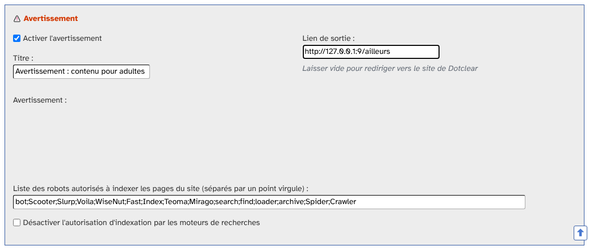
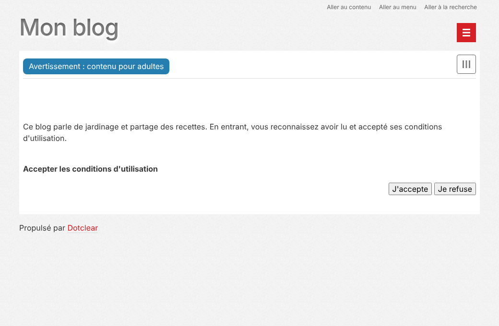

# Disclaimer : guide d'utilisation

Ce guide explique comment afficher un avertissement à l'entrée de votre blog avec le plugin _Disclaimer_.

Ce plugin n'a pas de page d'administration. Ses réglages sont dans les paramètres du blog.

## Sommaire

* [À quoi sert le plugin](#à-quoi-sert-le-plugin)
* [Activer l'avertissement](#activer-lavertissement)
* [Ce que voit le visiteur](#ce-que-voit-le-visiteur)
* [Les robots des moteurs de recherche](#les-robots-des-moteurs-de-recherche)
* [Modifier la page](#modifier-la-page)
* [Bon à savoir](#bon-à-savoir)

## À quoi sert le plugin

_Disclaimer_ affiche une page d'avertissement avant de laisser un visiteur entrer sur le blog. Le visiteur doit cliquer sur « J'accepte » pour continuer.

Il sert par exemple pour un blog réservé aux adultes ou soumis à des conditions d'utilisation.

## Activer l'avertissement

1. Allez dans _Blog_ puis _Paramètres du blog_.
2. Ouvrez la section _Paramètres des plugins pour ce blog_.
3. Remplissez le cadre _Avertissement_.
4. Enregistrez.

* _Activer l'avertissement_ : met l'avertissement en service. Tant que la case est décochée, le blog est ouvert à tous.
* _Titre_ : le titre de la page d'avertissement.
* _Lien de sortie_ : l'adresse où part le visiteur qui refuse. Laissez vide pour l'envoyer sur `http://www.dotclear.org`.
* _Avertissement_ : le texte affiché. L'éditeur de billets s'applique à ce champ s'il est actif.
* _Liste des robots autorisés à indexer les pages du site_ : voir plus bas.
* _Désactiver l'autorisation d'indexation par les moteurs de recherches_ : voir plus bas.

## Ce que voit le visiteur

Quelle que soit la page demandée, un visiteur qui n'a pas encore accepté voit la page d'avertissement.

* Un clic sur _J'accepte_ ouvre la page du blog demandée. Le choix est gardé pour la durée de la session.
* Un clic sur _Je refuse_ ferme la session et envoie le visiteur à l'adresse du _Lien de sortie_.

## Les robots des moteurs de recherche

Pour que votre blog reste visible dans les moteurs de recherche, les robots passent sans voir l'avertissement. Le plugin les reconnaît à leur identifiant (_user-agent_).

Le champ _Liste des robots autorisés_ contient des mots séparés par des points-virgules. Si l'identifiant d'un visiteur contient l'un de ces mots, il passe directement. La valeur par défaut est :

`bot;Scooter;Slurp;Voila;WiseNut;Fast;Index;Teoma;Mirago;search;find;loader;archive;Spider;Crawler`

Si vous videz le champ, la liste par défaut est utilisée.

Cochez _Désactiver l'autorisation d'indexation par les moteurs de recherches_ pour que tous les robots voient l'avertissement. Votre blog ne sera alors plus indexé.

## Modifier la page

Le plugin fournit un gabarit `disclaimer.html` pour chaque jeu de gabarits (_dotty_ et _mustek_) dans son dossier `default-templates/`. Copiez-le dans votre thème pour le changer.

Les balises disponibles sont :

* `{{tpl:DisclaimerTitle}}` : le titre ;
* `{{tpl:DisclaimerText}}` : le texte ;
* `{{tpl:DisclaimerFormURL}}` : l'adresse du formulaire.

Le style se règle dans le fichier `disclaimer.css`, chargé dans l'en-tête des pages.

## Bon à savoir

* **L'avertissement ne s'affiche qu'une fois par session, même sans accepter.** Si le visiteur recharge la page ou ouvre une autre page sans cliquer sur « J'accepte », il entre sur le blog. Seule la première page est bloquée.
* Les flux (Atom, RSS), le fichier `robots.txt` et les autres adresses du blog renvoient aussi la page d'avertissement aux visiteurs qui ne sont pas des robots reconnus. Les lecteurs de flux n'arrivent donc pas à lire le blog.
* Seuls les accès à l'API du plugin _ApiServer_ ne sont pas bloqués. Un autre plugin peut ajouter d'autres exceptions.
* La reconnaissance des robots se fait sur des morceaux de mots : un navigateur dont l'identifiant contient « find », « Fast » ou « Index » passe aussi sans avertissement. Les mots courts de la liste par défaut (« bot », « search », « find ») sont les plus larges.
* Le refus envoie le visiteur vers le lien de sortie sans message. Pensez à mettre une page d'accueil claire à cette adresse.
* Le texte de l'avertissement est affiché tel quel, avec son HTML.
